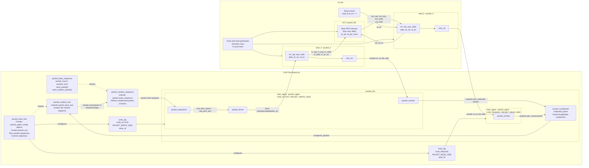

# Packet Protocol Verification Architecture

## 1. Purpose

This document describes the architecture of the SOP/EOP packet FIFO design and its UVM verification environment. It shows how stimulus travels from the test sequence to the DUT and how the input and output monitors send complete packets to the scoreboard for comparison.

The design uses a simple packet protocol with these signals:

- `clk`: common interface and DUT clock
- `rst`: active-high synchronous reset
- `sop`: start-of-packet marker
- `eop`: end-of-packet marker
- `valid`: indicates a valid data beat
- `data`: 8-bit packet data by default
- `wr_en`: write enable on the DUT input side
- `rd_en`: read enable on the DUT output side

## 2. Complete architecture diagram



## 3. Text architecture diagram

The same architecture is shown below for Markdown viewers that do not render Mermaid diagrams.

```text
+--------------------------------------------------------------------------------+
| UVM TESTBENCH                                                                  |
|                                                                                |
|  +-----------------------+                                                     |
|  | packet_random_test    |                                                     |
|  | extends base test     |                                                     |
|  |-----------------------|                                                     |
|  | Creates random_seq    |                                                     |
|  +-----------+-----------+                                                     |
|              | inherits common env setup, objections, start and wait           |
|              v                                                                 |
|  +-----------------------+                                                     |
|  | packet_base_test      |                                                     |
|  |-----------------------|                                                     |
|  | Creates packet_env    |                                                     |
|  | Runs packet sequences |                                                     |
|  +-----------+-----------+                                                     |
|              | runs                                                            |
|              v                                                                 |
|  +-----------------------+                                                     |
|  | packet_random_sequence|                                                     |
|  | extends base sequence |                                                     |
|  | Randomizes packet_item|                                                     |
|  +-----------+-----------+                                                     |
|              | inherits packet_count and send helpers                          |
|              v                                                                 |
|  +-----------------------+                                                     |
|  | packet_base_sequence  |                                                     |
|  +-----------+-----------+                                                     |
|              | packet_item                                                     |
|              v                                                                 |
|  +------------------------- packet_env -------------------------------------+  |
|  |                                                                         |  |
|  |  +------------- packet_agent (ACTIVE) -------------------------+ |  |
|  |  |                                                                   | |  |
|  |  |  +------------------+      +------------------+                    | |  |
|  |  |  | packet_sequencer |----->| packet_driver    |                    | |  |
|  |  |  +------------------+ TLM  +---------+--------+                    | |  |
|  |  |                                      | drive                       | |  |
|  |  |  +----------------------+            |                             | |  |
|  |  |  | packet_monitor |<-----------+-- observes write_if         | |  |
|  |  |  +-----------+----------+                                          | |  |
|  |  +--------------|-----------------------------------------------------+ |  |
|  |                 | expected packet                                       |  |
|  |                 v                                                       |  |
|  |          +--------------------+                                          |  |
|  |          | packet_scoreboard  |                                          |  |
|  |          |--------------------|                                          |  |
|  |          | expected_queue     |                                          |  |
|  |          | compare length/data|                                          |  |
|  |          +----------+---------+                                          |  |
|  |                     ^ actual packet                                      |  |
|  |                     |                                                    |  |
|  |  +------------- packet_agent (PASSIVE) -------------------------+  |  |
|  |  |  +---------------------+                                           |  |  |
|  |  |  | packet_monitor |<--------- observes read_if                |  |  |
|  |  |  +---------------------+                                           |  |  |
|  |  +--------------------------------------------------------------------+  |  |
|  +-------------------------------------------------------------------------+  |
+--------------------------------------------------------------------------------+
                         |                              ^
                         | write stimulus               | DUT output
                         v                              |
+--------------------------------------------------------------------------------+
| HDL TOP: tb_top                                                                |
|                                                                                |
|  +--------------------+    +----------------------+    +--------------------+  |
|  | write_if           |    | packet_fifo DUT      |    | read_if            |  |
|  |--------------------|    |----------------------|    |--------------------|  |
|  | sop                |--->| in_sop               |    | sop                |  |
|  | eop                |--->| in_eop               |--->| eop                |  |
|  | valid              |--->| in_valid             |--->| valid              |  |
|  | data               |--->| in_data              |--->| data               |  |
|  | wr_en              |--->| in_wr_en             |    | wr_en = 0          |  |
|  | rd_en = 0          |    | out_rd_en            |<---| rd_en = 1          |  |
|  | mon_cb             |    |                      |    | mon_cb             |  |
|  +--------------------+    | {sop,eop,data} memory|    +--------------------+  |
|                            | wr_ptr, rd_ptr, count |                            |
|                            +----------------------+                            |
|                                                                                |
|           Common clk and rst connect the interfaces and DUT                    |
+--------------------------------------------------------------------------------+
```

## 4. Static HDL architecture

`tb_top` is the static SystemVerilog testbench top. It provides objects that cannot be created inside UVM classes:

- Clock generation
- Reset generation
- Two `packet_if` interface instances
- The `packet_fifo` DUT instance
- Constant read-side control
- Virtual-interface registration
- The call to `run_test()`

### Interface instances

```systemverilog
packet_if #(DATA_WIDTH) write_if(clk);
packet_if #(DATA_WIDTH) read_if(clk);
```

The interfaces have the same signal declarations but different roles:

| Interface | Role | Primary signal driver | Monitor |
|---|---|---|---|
| `write_if` | DUT input interface | `packet_driver` | `packet_monitor` |
| `read_if` | DUT output interface | `packet_fifo` | `packet_monitor` |

Because the read agent is passive, `tb_top` keeps the output consumer enabled:

```systemverilog
assign read_if.rd_en = 1'b1;
```

The unused opposite-direction enables are held inactive:

```systemverilog
assign read_if.wr_en  = 1'b0;
assign write_if.rd_en = 1'b0;
```

### DUT port mapping

| DUT port | Connected signal | Function |
|---|---|---|
| `clk` | `clk` | Common clock |
| `rst` | `write_if.rst` | Active-high synchronous reset |
| `in_sop` | `write_if.sop` | Input first-beat marker |
| `in_eop` | `write_if.eop` | Input final-beat marker |
| `in_valid` | `write_if.valid` | Input beat validity |
| `in_data` | `write_if.data` | Input byte |
| `in_wr_en` | `write_if.wr_en` | Input write request |
| `out_sop` | `read_if.sop` | Output first-beat marker |
| `out_eop` | `read_if.eop` | Output final-beat marker |
| `out_valid` | `read_if.valid` | Output beat validity |
| `out_data` | `read_if.data` | Output byte |
| `out_rd_en` | `read_if.rd_en` | Output read request |

## 5. UVM component hierarchy

Inheritance and runtime hierarchy:

```text
packet_base_test
`-- packet_random_test                         instantiated as uvm_test_top
    `-- env                                    packet_env
        |-- write_agent                        packet_agent
        |   |-- sequencer                      packet_sequencer
        |   |-- driver                         packet_driver
        |   `-- monitor                        packet_monitor
        |-- read_agent                         packet_agent
        |   `-- monitor                        packet_monitor
        `-- scoreboard                         packet_scoreboard

packet_base_sequence
`-- packet_random_sequence                     runs on write_agent.sequencer
```

The base test configures two instances of the same agent class before creating the environment:

```text
write_agent : packet_agent
  write_cfg.is_active = UVM_ACTIVE
  write_cfg.role      = PACKET_WRITE_SIDE
  write_cfg.vif       = write_vif

read_agent : packet_agent
  read_cfg.is_active  = UVM_PASSIVE
  read_cfg.role       = PACKET_READ_SIDE
  read_cfg.vif        = read_vif
```

Each instance always creates `packet_monitor`. Only the active write instance creates `packet_sequencer` and `packet_driver`.

## 6. Stimulus path

The stimulus path carries complete packet transactions down to cycle-level DUT signals:

```text
packet_random_test
    |
    | inherits env and run_packet_sequence()
    v
packet_base_test
    |
    | starts packet_random_sequence on env.write_agent.sequencer
    v
packet_random_sequence
    |
    | inherits packet_count and send helpers
    v
packet_base_sequence
    |
    | randomized packet_item
    v
packet_sequencer
    |
    | seq_item_export/seq_item_port TLM connection
    v
packet_driver
    |
    | sop, eop, valid, data, wr_en
    v
write_if
    |
    | in_sop, in_eop, in_valid, in_data, in_wr_en
    v
packet_fifo DUT
```

`packet_item` represents a complete packet. Its dynamic `payload[]` array contains one byte per protocol beat. The driver serializes the array onto `write_if`, asserting SOP on the first byte and EOP on the final byte.

The DUT accepts a write beat when:

```systemverilog
in_wr_en && in_valid && (count < DEPTH)
```

## 7. Expected-data path

The expected path is independent of the sequence object:

```text
write_if.mon_cb
    |
    | write request: wr_en && valid
    v
packet_monitor
    |
    | reconstruct packet from SOP through EOP
    v
write_agent.monitor.ap
    |
    | packet_item
    v
scoreboard.expected_export
    |
    v
expected_queue
```

Using an interface monitor as the expected source checks what was actually presented to the DUT. The write monitor samples `wr_en && valid`; it does not observe the DUT's internal full condition. Therefore, expected traffic matches accepted DUT traffic while the testbench obeys the no-overflow protocol requirement. The DUT assertion `a_no_write_when_full` reports a violation if a write is requested while full.

The write monitor reports protocol errors when:

- A new SOP arrives before the active packet reaches EOP.
- An accepted non-SOP beat arrives when no packet is being collected.

## 8. Actual-data path

The actual path observes the DUT output:

```text
packet_fifo DUT
    |
    | out_sop, out_eop, out_valid, out_data
    v
read_if.mon_cb
    |
    | consumed beat: rd_en && valid
    v
packet_monitor
    |
    | reconstruct packet from SOP through EOP
    v
read_agent.monitor.ap
    |
    | packet_item
    v
scoreboard.actual_export
```

The DUT consumes a read beat when:

```systemverilog
out_rd_en && out_valid
```

The read monitor reports protocol errors for nested SOP markers or output data that appears before SOP.

## 9. Scoreboard connections and behavior

The environment establishes these analysis connections during `connect_phase`:

```systemverilog
write_agent.monitor.ap.connect(scoreboard.expected_export);
read_agent.monitor.ap.connect(scoreboard.actual_export);
```

The scoreboard uses two analysis implementation callbacks:

| Input | Callback | Action |
|---|---|---|
| `expected_export` | `write_expected()` | Clone and queue the expected packet |
| `actual_export` | `write_actual()` | Remove the oldest expected packet and compare it with the actual packet |

The comparison checks:

- Packet presence
- Packet length
- Every payload byte in order
- Unexpected output packets
- Expected packets remaining at the end of the test

`compared_packets` increments after every expected-versus-actual comparison. The test waits for this counter to reach the requested packet count before dropping its run-phase objection.

## 10. Clock and reset architecture

`tb_top` generates a 100 MHz clock:

```systemverilog
always #5 clk = ~clk;
```

Reset is active high and synchronous to the DUT clock. It remains asserted for five rising edges:

```systemverilog
write_if.rst = 1'b1;
repeat (5) @(posedge clk);
write_if.rst <= 1'b0;
```

`read_if.rst` is connected to the same reset source. Both monitors sample through `mon_cb` at `posedge clk` with `#1step` input skew. During reset, each monitor discards any partially collected packet.

## 11. Agent configuration and virtual-interface connections

`tb_top` registers the two physical interfaces for the base test before starting UVM:

```systemverilog
uvm_config_db#(virtual packet_if)::set(
  null, "uvm_test_top", "write_vif", write_if
);

uvm_config_db#(virtual packet_if)::set(
  null, "uvm_test_top", "read_vif", read_if
);
```

`packet_base_test` retrieves these handles, creates `write_cfg` and `read_cfg`, and sets each `packet_agent_config` on its agent instance:

```systemverilog
uvm_config_db#(packet_agent_config)::set(
  this, "env.write_agent", "cfg", write_cfg
);
uvm_config_db#(packet_agent_config)::set(
  this, "env.read_agent", "cfg", read_cfg
);
```

Each `packet_agent` passes the same configuration object to the components it creates. The active write driver and monitor therefore use `write_if`; the passive read monitor uses `read_if`.

## 12. End-to-end packet flow

For each packet, the architecture operates as follows:

1. `packet_random_test`, derived from `packet_base_test`, creates `packet_random_sequence`.
2. The inherited `run_packet_sequence()` helper raises an objection and starts the sequence on the write sequencer.
3. `packet_random_sequence`, derived from `packet_base_sequence`, creates and randomizes `packet_item` objects containing one to eight bytes.
4. The base sequence helper performs the sequencer-item handshake.
5. The sequencer transfers each item to `packet_driver`.
6. The driver serializes the payload onto `write_if` with SOP and EOP markers.
7. The DUT stores each accepted `{sop, eop, data}` beat in FIFO memory.
8. The write monitor reconstructs the input packet and sends it to `scoreboard.expected_export`.
9. The DUT presents the oldest FIFO beat on `read_if`.
10. Since `read_if.rd_en` is high, each valid output beat is consumed.
11. The read monitor reconstructs the output packet and sends it to `scoreboard.actual_export`.
12. The scoreboard compares the actual packet against the oldest expected packet.
13. After the sequence finishes, the base test helper uses `packets_sent` to wait for the corresponding scoreboard comparisons and then drops its objection.
14. The scoreboard checks for missing expected packets and reports the comparison total.

## 13. Connection summary

| Source | Destination | Connection type | Information carried |
|---|---|---|---|
| `packet_random_test` | `packet_base_test` | Class inheritance | Common environment setup and execution helper |
| `packet_random_test` | `packet_random_sequence` | UVM object creation | Random-packet scenario control |
| `packet_random_sequence` | `packet_base_sequence` | Class inheritance | Packet count and send helpers |
| `packet_random_sequence` | `packet_sequencer` | UVM sequence API | Randomized `packet_item` |
| `packet_sequencer` | `packet_driver` | Sequencer-driver TLM | Complete packet transaction |
| `packet_driver` | `write_if` | Virtual interface | SOP, EOP, valid, data, write enable |
| `write_if` | `packet_fifo` | HDL port connection | DUT input packet beats |
| `write_if.mon_cb` | `packet_monitor` | Virtual-interface sampling | Accepted input beats |
| `packet_monitor.ap` | `scoreboard.expected_export` | UVM analysis TLM | Expected complete packets |
| `packet_fifo` | `read_if` | HDL port connection | DUT output packet beats |
| `tb_top` | `read_if.rd_en` | Continuous assignment | Permanent output read enable |
| `read_if.mon_cb` | `packet_monitor` | Virtual-interface sampling | Consumed output beats |
| `packet_monitor.ap` | `scoreboard.actual_export` | UVM analysis TLM | Actual complete packets |
| `packet_scoreboard.compared_packets` | `packet_base_test.run_packet_sequence()` | Shared component state/wait | Test completion condition |
| `tb_top` | `packet_base_test` | `uvm_config_db` | `write_vif` and `read_vif` handles |
| `packet_base_test` | Both `packet_agent` instances | `packet_agent_config` | Activity, role, and virtual interface |

## 14. Source-file ownership

| Architectural block | Source file |
|---|---|
| DUT | `rtl/packet_fifo.sv` |
| Packet interface | `tb/packet_if.sv` |
| Transaction | `tb/uvc/packet_item.sv` |
| Sequencer | `tb/uvc/packet_sequencer.sv` |
| Driver | `tb/uvc/packet_driver.sv` |
| Agent configuration and role enum | `tb/uvc/packet_agent_config.sv` |
| Shared write/read monitor | `tb/uvc/packet_monitor.sv` |
| Configurable active/passive agent | `tb/uvc/packet_agent.sv` |
| Scoreboard | `tb/env/packet_scoreboard.sv` |
| Environment | `tb/env/packet_env.sv` |
| Base sequence | `tb/sequences/packet_base_sequence.sv` |
| Random sequence | `tb/sequences/packet_random_sequence.sv` |
| Base test | `tb/tests/packet_base_test.sv` |
| Random test | `tb/tests/packet_random_test.sv` |
| UVM package | `tb/packet_uvc_pkg.sv` |
| HDL top | `tb/tb_top.sv` |
